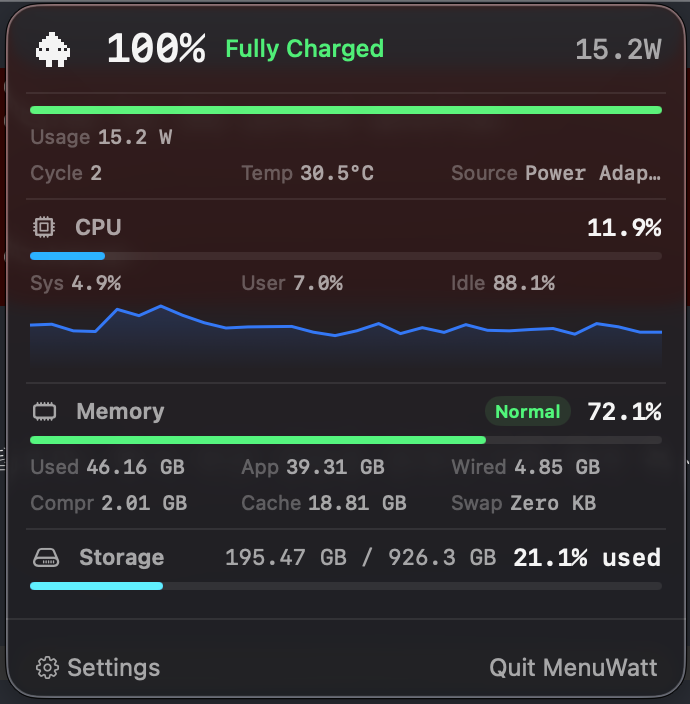

# MenuWatt

A lightweight macOS menu bar app that shows real-time power usage, battery status, and system metrics.



## Install

**Homebrew:**

```bash
brew tap Ketchio-dev/menuwatt
brew install --cask menuwatt
```

**Manual:** Download the DMG from the [latest release](https://github.com/Ketchio-dev/MenuWatt/releases/latest), open it, and drag MenuWatt to Applications.

> On first launch, macOS may block the app. Run `xattr -cr /Applications/MenuWatt.app` or go to **System Settings > Privacy & Security > Open Anyway**.

## Features

- Live system power (W) in the menu bar
- Battery percentage, charge rate and temperature
- CPU, GPU and network history graphs with a saved On/Off setting
- Memory pressure and breakdown
- Storage usage
- Animated pixel character that speeds up with system load
- Optional macOS 27 menu bar cleanup: Visible, Hidden and Always Hidden app groups
- Hide the large microphone/camera controls while audio keeps playing normally

## Dashboard settings

In **Settings → Overview → Dashboard**, turn **Show graphs** off for a shorter
popover. Current values and background sampling continue; the preference survives
relaunch. Click anywhere on the CPU, memory, fan or network header row to expand
its details, not just the chevron. Top Energy shows up to five processes at first.
Use **Show more processes** to see up to 15 ranked processes in the dashboard.
The dashboard scrolls when needed and keeps Settings/Quit in its footer.

Cycle count and power-source metadata no longer occupy a dashboard row. Menu bar
cleanup controls are in **Settings → Menu Bar**, not in the monitoring popover.

## Menu bar cleanup (macOS 27)

Open **Settings → Menu Bar**, enable cleanup, and choose which apps and system
icons to keep visible. Icons owned by one bundle share one choice; running
menu bar helpers (such as Passwords) appear separately from their parent apps.
The list contains running app candidates and saved choices, not detected icons;
apps without an icon are unaffected. Search accepts names or bundle identifiers,
and saved choices remain available when an app is not running.

**Show Hidden** reveals the Hidden group; **Show All** also reveals Always
Hidden. Icons can collapse again after 15 seconds. Native ⌘-drag continues to
control their order. Sleep releases the visibility session; wake reapplies a
fresh, collapsed layout without changing saved assignments, unless you paused
cleanup manually.

**Reveal on hover** is optional and off by default. It uses the actual visible
menu bar bounds on each screen, including taller bars on notched displays.
A hidden bar or full-screen edge does not trigger it until macOS shows the bar.
Hover reveals Hidden icons, never Always Hidden; leaving collapses them after
a one-second grace period. Native menus, menu-bar-attached floating/modal
popups and mouse-button drags defer automatic collapse. Custom app panels at
other window levels may not be detected; turn off automatic collapse or use a
manual reveal if needed. Pointer position and window bounds/levels are polled
locally, without images, window titles, input interception or extra permissions.
Manual Show Hidden/Show All takes over from hover and retains its own timer.

**Keep large microphone / camera controls hidden** stays enabled by default, so
revealing app icons does not bring the large activity pill back. This changes
the menu bar's presentation, not audio playback, microphone permissions or
recording. macOS continues to control its small privacy indicator.

Global shortcuts while cleanup is enabled:

- **⌃⌥⌘M**: reveal/collapse Hidden icons
- **⌃⌥⌘R**: disable cleanup and restore the system menu bar

The macOS 27 visibility mode also removes Focus and some media extras. Clicking
the clock can stop opening Notification Center while that mode is active.
Use **Pause Cleanup** to release that mode while using native controls without
turning the feature off or changing saved choices. All icons may return during
the pause, including Always Hidden and the large microphone/camera controls.
Pause has no timer: **Resume Cleanup** explicitly reapplies the current choices
in their collapsed state. Refresh, sleep/wake and the reveal shortcut do not
resume it. Pause is temporary for this app run; relaunching starts cleanup again
if it is still enabled.

**Restore Menu Bar** instead turns cleanup off and releases the mode, retaining
your assignments. Exiting MenuWatt also releases it. The clock, Control Center
and MenuWatt itself are always allowed by the cleanup policy.

The native adapter is implemented in this repository and resolves
`MenuBarClientCore` at runtime. The API is private and can change after an OS
update; unavailable APIs or activation failures leave the normal menu bar in
place. Cleanup is opt-in and is unavailable on macOS 13–26. It does not require
Screen Recording, Accessibility, Input Monitoring, root privileges or changes
to SIP. MenuWatt's existing MIT license is retained.

For the runtime behavior investigated during development, see
[Dimble's FAQ](https://github.com/fif7y/dimble/blob/main/docs/FAQ.md),
[Dimble's assertion handoff](https://github.com/fif7y/dimble/blob/1fc7ff907b8c3ffb336967883d6cd0eab3354624/Packages/PelmetEngine/Sources/PelmetEngine/AgentBarEngine.swift#L735-L781),
and [Thaw's release notes on app-launch redraws](https://github.com/thaw-app/Thaw/releases/tag/3.0.0-beta.4).

## How It Works

MenuWatt reads system power directly from the **SMC** (System Management Controller) via IOKit. Battery metadata comes from `AppleSmartBattery` in the IOKit registry. CPU and memory stats use Mach `host_statistics`; network rates use 64-bit routing counters and monotonic elapsed time. Monitoring is local, without a separate daemon. Optional version checks call GitHub's releases API.

Top Energy is an estimated CPU-time/wakeup impact score per sample, not per-app
watts or Activity Monitor's exact score. Longer refresh intervals can produce
larger scores; total power measurement is separate. Sensors unavailable on a
particular Mac show an unavailable state rather than a measured zero.

Works on all Apple Silicon Macs (M1-M5) without root privileges.

## Development

```bash
./scripts/test.sh         # Run tests
./scripts/build-app.sh    # Build release .app
./scripts/build-app.sh --preview # Separate bundle ID and preferences for testing
./scripts/package-dmg.sh  # Package DMG
```

Requires Xcode and [xcodegen](https://github.com/yonaskolb/XcodeGen).
For cleanup regression tests without the test script's HOME override, use
`swift test --scratch-path .build-cleanup-tests --no-parallel`. The explicit
serial flag avoids short lifecycle timers racing against cold AppKit rendering.
Lifecycle tests inject a fake runtime and do not hide the real menu bar or
register global hotkeys. Settings tests use non-visible windows, isolated
preferences and a stub update session; they never activate an app. Optional
native renders can be exported with `MENUWATT_RENDER_SETTINGS_DIR=<directory>`.

The preview is `MenuWattPreview.app` in `.build-app-preview/`. Run it from a
stable location such as `/Applications` so macOS can register its status item.
The regular build and the installed MenuWatt have separate preferences and
Launch at Login agents from this preview. Older Preview login files that
explicitly target Preview move to its own agent without losing the opt-in;
a regular MenuWatt login file is never adopted. Preview startup does not request
notifications or check updates. Do not use `open -j` (hidden launch) for the
Preview: a trial on this host left its window-style menu bar popover invisible;
relaunching without `-j` restored physical left-click operation.

For a build containing the paused-start option, quit any existing instance and
launch its executable with:

```bash
MENUWATT_START_CLEANUP_PAUSED=1 /path/to/MenuWattPreview.app/Contents/MacOS/MenuWattPreview
```

If cleanup is already enabled and supported, it starts **paused before creating
any visibility session**. Settings and monitoring still work. Saved opt-in,
assignments and options are kept; refresh, edits and sleep/wake do not resume it.
Use **Settings → Menu Bar → Resume Cleanup** to apply the current choices.
Disabling cleanup clears the pause, as it does during an ordinary manual pause.
The option is read only at launch: passing it to an already-running instance
does not pause that instance. Without it, normal saved-start behavior is unchanged.

This is a development/recovery entry point, not a fix for the macOS menu bar
failure. Resume still uses the private visibility API with its documented system
control limitations. The app does not restart macOS menu bar services itself.

## Support

Questions, bug reports, or feature requests:

- [GitHub Issues](https://github.com/Ketchio-dev/MenuWatt/issues)
- [Discord community](https://discord.gg/Cc2RGrN7dh)

## License

[MIT](LICENSE)
